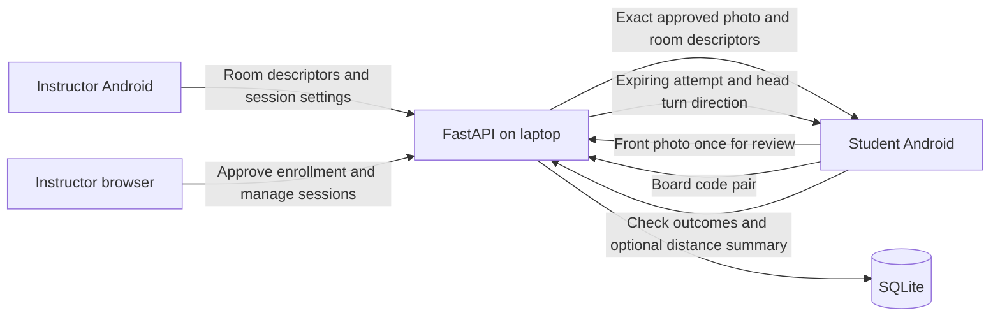

# ClassSweep algorithms and engineering handoff

ClassSweep is an Introduction to Computer Vision prototype for checking attendance with an Android phone and a Linux laptop. The phone reads two handwritten codes, checks scene geometry, compares optical motion with the gyroscope, verifies the enrolled student against a local face reference, and rechecks the board. An instructor can also require a location check. The server manages enrollment approval, session expiry, and attendance records. Its acceptance decision uses evidence reported by the app, so a successful check-in documents that the protocol accepted the result. It is not independent proof of presence.

This guide covers the Android 1.3 workflow and the server 0.2 API. The student and instructor use the same Android build. Instructor roles and student roles have separate authentication. iOS remains a separate build and validation effort. See the [rehearsal guide](PHONE_TEST.md) for an operational checklist, the [API contract](../server/API.md) for the wire format, and the [validation record](VALIDATION.md) for current evidence.

## System map



The Android app uses Flutter and Dart for the UI and state machines, Google ML Kit for text, face detection and head pose, and native OpenCV via `opencv_dart` for image conversion, local features, motion and SFace embeddings. The server uses Python, FastAPI, Pydantic, Pillow and SQLite. The browser dashboard is server-rendered HTML and CSS. No web host, projector, visual markers or separate inference server is required for normal rehearsals.

### Source map

The path names below are relative to the repository. Search by symbol rather than relying on line numbers after editing.

| Concern | Files and important entry points |
| --- | --- |
| Android entry and roles | [main.dart](../mobile/lib/main.dart) registers the Android Camera2 plugin. [classsweep_app.dart](../mobile/lib/app/classsweep_app.dart) selects sign-in, instructor workspace or student dashboard. [account_pages.dart](../mobile/lib/app/account_pages.dart) handles sign-in, registration, password suggestions and server settings. |
| Authentication and local state | [app_model.dart](../mobile/lib/app/app_model.dart) owns `authenticate`, `verifyAccount`, `refresh` and `ensureFace`. [local_store.dart](../mobile/lib/app/local_store.dart) stores the root URL, installation ID, token, references and pending pose embeddings. |
| Instructor app | [instructor_home.dart](../mobile/lib/app/instructor_home.dart) links to setup. [instructor_page.dart](../mobile/lib/app/instructor_page.dart) creates sessions, handles test codes, lists active sessions, turns GPS off and closes sessions. |
| Calibration and enrollment UI | [photo_page.dart](../mobile/lib/app/photo_page.dart) handles consent, capture results and upload. [capture_screen.dart](../mobile/lib/app/capture_screen.dart) supplies `ClassroomCamera`, `GuidedFaceCamera` and the face oval. |
| Camera runtime and zoom | [camera_pane.dart](../mobile/lib/app/camera_pane.dart) controls camera enumeration, lens transitions, lifecycle, frames, still capture and zoom. [camera_conversion.dart](../mobile/lib/vision/camera_conversion.dart) contains `frameRotation`, `packNv21` and `cameraBgr`. |
| Check-in coordination | [dashboard.dart](../mobile/lib/app/dashboard.dart) shows approval, open sessions and results. [attendance_page.dart](../mobile/lib/app/attendance_page.dart) coordinates the scan, face, rear recheck, location and submission stages. |
| Algorithms and representations | [vision.dart](../mobile/lib/vision/vision.dart) integrates OpenCV, OCR, face tracking and gyro. [evidence.dart](../mobile/lib/vision/evidence.dart) has `CodeVoter`, `BoardCodeScan`, `SweepChallenge`, `HeadChallenge`, median and correlation. [references.dart](../mobile/lib/vision/references.dart) validates face and scene reference data and defines `SceneMatch.passed`. |
| Location | [location_provider.dart](../mobile/lib/location/location_provider.dart) defines samples and failures. [geolocator_provider.dart](../mobile/lib/location/geolocator_provider.dart) manages device location. [gps_policy.dart](../mobile/lib/location/gps_policy.dart) defines the math and wire objects. [location_verifier.dart](../mobile/lib/location/location_verifier.dart) checks fixes and distance. [attendance_location.dart](../mobile/lib/network/attendance_location.dart) revalidates the live policy. |
| Phone HTTP | [api_client.dart](../mobile/lib/network/api_client.dart) handles URL normalization, transport timeouts, auth, upload, exact approved bytes, and admin and student operations. |
| Server | [app.py](../server/classsweep/app.py) contains all route handlers, auth, private response headers, transaction boundaries, validation and CSV export. [models.py](../server/classsweep/models.py) defines strict Pydantic requests. [storage.py](../server/classsweep/storage.py) owns SQLite schema, migrations, hashing and connections. [dashboard.py](../server/classsweep/dashboard.py) renders escaped HTML and inline local CSS. |
| Packaging | [pubspec.yaml](../mobile/pubspec.yaml) and [pubspec.lock](../mobile/pubspec.lock) fix app build inputs. [app/build.gradle.kts](../mobile/android/app/build.gradle.kts) and [AndroidManifest.xml](../mobile/android/app/src/main/AndroidManifest.xml) define the Android package and permissions. [models.json](../scripts/models.json) pins weights. [fetch_models.py](../scripts/fetch_models.py), [build_android.sh](../scripts/build_android.sh) and [checks.yml](../.github/workflows/checks.yml) fetch, check and package. |
| Laptop operation | [setup_server.sh](../scripts/setup_server.sh) installs the venv. [run_server.py](../scripts/run_server.py) starts Uvicorn and supervises the temporary alias. [lan.py](../scripts/lan.py) chooses the interface and manages Avahi. [AGENTS.md](../AGENTS.md) contains repository delivery rules. |

## End-to-end control flow

1. The instructor calibrates the board once from a representative viewpoint. Saving sends a room name and local ORB features. Subsequent calibration creates a new reference ID. A session stays pinned to the reference that existed when it was created.
2. The instructor creates a timed session and displays the two four-digit codes far enough apart to require a pan. The order in which a student reads the codes can differ from their order in the instructor UI. The instructor can enable GPS with a fresh center and radius or leave it off.
3. The student registers on one installation, takes three guided enrollment stills, consents to share the front photo, and waits for approval. The app prepares the approved reference automatically after refresh, including while the pending page polls every six seconds in the foreground.
4. The student opens a session from the dashboard. `AttendancePage._prepare` refreshes the account, obtains the local face reference, starts its vision instance, loads the current session policy and downloads the pinned room reference. The phone currently uses the **first** room view even though the server wire schema supports up to six.
5. The rear camera accepts one code, the student chooses the direction to the other code, and the app measures a pan, stationary hold and reverse pan. A valid room match and both distinct codes are required. The board codes need not be visible in the same frame.
6. The server checks the submitted pair against the selected session, then returns a one-use attempt and a random left or right head turn. The phone switches to the front camera and runs the identity and pose state machine.
7. After the face step succeeds, the phone switches back to the rear camera. It clears prior recheck evidence so a fresh room match and a reobserved code are required. The two observations must be recent within three seconds at the moment the recheck passes.
8. On submit, the app refreshes the live GPS requirement and checks location if required. It sends the resulting summaries with the attempt identifiers. The server accepts the attendance atomically or returns a rejection. The student can confirm a saved row under **My attendance**, and the instructor can export the session CSV.

## Camera frames and zoom

The Android entry point explicitly registers `camera_android`. `CameraPane` picks the first camera matching the front or rear lens direction. Its controller uses `ResolutionPreset.medium` with audio off and locks capture orientation to portrait up. The preview shows the available image at its aspect ratio. While processing live frames, the pane skips incoming frames if inference is active, the camera is changing zoom, or a still is being taken. A 120 ms admission interval puts a ceiling on processed frame frequency. The actual frequency depends on the camera and inference time.

Camera streams provide byte planes with row and pixel padding. `packNv21` accepts a packed NV21 plane or repacks three planes from YUV420. The Y plane comes first, followed by interleaved V,U chroma sampled at half width and height. The code respects both row and pixel strides in YUV420 and strips row padding in NV21. It requires even dimensions. The iOS-oriented branch packs BGRA rows, though the project has yet to validate that path on an iPhone. OpenCV converts NV21 or BGRA to BGR and applies 0°, 90°, 180° or 270° rotation. ML Kit receives the original packed bytes, input dimensions and rotation metadata. Front-camera orientation adds device rotation to sensor rotation. Rear-camera orientation subtracts it. Testing all supported orientations on a real device matters because a preview can look upright while a frame has the wrong metadata.

For most OpenCV image operations, `_small` scales the longest edge to at most 960 px without changing aspect ratio. ML Kit OCR receives the original camera stream dimensions. Classroom still capture reads the camera's JPEG into memory, deletes its plugin temporary file, bakes EXIF orientation and downsizes stills with an edge above 1600 px before ORB extraction. The room photo is never uploaded.

Version 1.3 uses the camera controller's minimum and maximum supported zoom and calls `setZoomLevel` on the active rear camera. Thus zoom changes the camera input observed by both preview and algorithms. The UI does not simulate zoom by enlarging a widget. The step is 0.5× over a short supported range and 1× otherwise, with the final value clamped to the device's limits. The rear zoom level is remembered for the current check-in, including after the app returns from the selfie camera. Its hardware limits can depend on the device and chosen camera. Digital crops can enlarge text but narrow the field and may not add readable detail. [Flutter camera controller documentation](https://pub.dev/documentation/camera/latest/camera/CameraController-class.html)

The student can adjust zoom before choosing a pan direction, while seeking the second code, after the sweep completes, or during the rear recheck. The app locks the zoom during the measured pans and the stationary hold after detecting the second code. A crop change can look like large optical motion even when the phone did not move. The app waits for the current frame, blocks new inference while it applies the crop, waits 240 ms for the stream to settle, and clears previous grayscale, OCR votes and cached scene observations. It preserves the completed parts of the sweep and the already accepted code values. Recheck markers are cleared so a room observation from one crop cannot combine with a code from the next. The first frame after reset supplies a baseline rather than a motion measurement. `CameraPane` serializes disposal and camera switching, while `AttendancePage` checks a stage generation before applying asynchronous results.

Keep native camera and frame work serialized. The vision facade rejects overlapping calls, and native `Mat` and vector objects are explicitly disposed. When opening a camera fails, inspect permission, the plugin lifecycle, and whether the previous camera was released. A lost foreground camera session makes the attendance page restart rather than continue with mixed evidence.

## Board text recognition and voting

ML Kit Text Recognition v2 is configured for the Latin script. It consumes a frame and returns recognized text, with richer line and bounding data available in the library. ClassSweep uses the flattened text. It does not train a recognizer, segment a fixed board region, or perform Arabic or Persian numeral normalization. The prototype expects four ASCII digits and preserves leading zeroes by treating codes as strings. [Google ML Kit Text Recognition v2](https://developers.google.com/ml-kit/vision/text-recognition/v2)

The extraction expression for the current four-digit configuration is `(?<![0-9])[0-9]{4}(?![0-9])`. The boundary tests prevent a substring of a longer number from becoming a candidate. A four-digit number elsewhere on the board can still interfere. `CodeVoter` deduplicates each frame's codes with a set. A code becomes stable at three separate observations within a three-second window. Duplicate and out-of-order timestamps cannot add votes. Empty fresh frames allow old votes to age out. OCR is scheduled once per 300 ms at most. A result carries `ocrFresh` and the timestamp of its last recognition.

`BoardCodeScan.observe` intersects codes in the current OCR result with stable votes. It locks the first code when exactly one candidate is present. During the seeking phase at the other end, it removes the first code from that set and accepts a unique second one. The student first isolates one code, then follows a directional arrow. The instructor must write the codes clearly and large enough for the last row. Additional four-digit numbers, glare, very tight crops or motion blur are the first things to check if a code chip never fills.

The two strings go to `POST /api/attempts` with the selected session ID. The server compares the set against that session's effective pair in a write transaction. It does not return the expected pair through any student session route. A valid text observation by itself confirms neither room nor identity. The rear recheck needs a fresh stable observation of either already accepted code and a current scene match.

## ORB features and geometric room verification

ORB combines oriented FAST keypoints with a rotated binary descriptor based on BRIEF. The descriptor records intensity comparisons around a point in a local orientation. A pyramid lets the extractor find features at more than one scale. Binary descriptors allow a Hamming comparison instead of distance over floating-point vectors. Calibration and live matching use the same OpenCV extractor with an 800-feature target and the same resize limit. [Rublee et al., ICCV 2011](https://doi.org/10.1109/ICCV.2011.6126544)

During calibration, the app serializes a view ID, pixel width, pixel height, keypoint coordinates and one 32-byte descriptor per point. The app's `SceneReference` requires at least 12 points. The server accepts 8–2,000 per view and checks array counts, numeric ranges, dimensions, distinct view IDs and descriptor byte values. Avoid a blank board or temporary objects that will disappear between capture and class. Board trim, fixed posters and other high-contrast details on or near the same plane are better anchors.

For a frame the matcher uses brute-force Hamming distance, `knnMatch(..., 2)`. For each live descriptor it keeps the closest candidate only if its distance is strictly below 0.75 times the second-closest distance and at most 64 bits. The ratio filters ambiguous matches. The absolute ceiling rejects pairs for which even the nearest descriptor is too far away. The code uses each reference keypoint once. This is a greedy deduplication, so the first accepted query for a reference point wins. [OpenCV feature matching](https://docs.opencv.org/4.x/dc/dc3/tutorial_py_matcher.html)

The retained pairs map live `(x,y)` points to reference coordinates. `findHomography` estimates a projective transformation with RANSAC and a 4 px reprojection threshold. In homogeneous form, a correct pair approximately satisfies `p_ref ∼ H × p_live`, after dividing by the third homogeneous coordinate. RANSAC favors a transformation with many agreeing point pairs despite false descriptor matches. The code counts the inlier mask only if the matrix is nonempty. It does not infer 3D location from it. Homography estimation needs at least four point pairs. The application requires at least 16 retained matches, 12 inliers and an inlier ratio of at least 0.45 to accept a frame. [OpenCV homography and object localization tutorial](https://docs.opencv.org/4.x/d1/de0/tutorial_py_feature_homography.html)

A successful room match can be observed anywhere during the initial sweep and is retained for that scan. The final rear recheck requires new evidence. ORB matching is scheduled separately from OCR, both at intervals of at least 300 ms, so the recheck allows the positive scene and code measurements to come from nearby frames. A change in camera zoom invalidates cached recheck measurements. Far seats, crops with little background, heavy parallax, repeated patterns or steep viewpoints can reduce the number of reliable pairs. Try a less tight zoom and a more textured reference before tuning thresholds. Multiple calibrated views would be a reasonable extension, but merely uploading additional views has no effect while the mobile app reads only the first.

## Optical flow and phone motion

### Why two signals are used

A board image can move across the camera frame because the phone rotates, because the scene moves, or because someone moves a screen in front of the lens. Optical flow measures motion in the image. The gyroscope measures angular velocity of the handset. Comparing the two signals makes a basic stationary replay less likely to pass. The test is a consistency check on a roughly horizontal pan, and somebody moving a phone in front of a screen can still produce correlated motion. It does not integrate the path into a room position.

### Sparse flow and robust aggregation

The classical Lucas–Kanade method assumes that brightness is approximately constant over a short time and that neighboring pixels move similarly. Linearizing brightness constancy gives `Ix * vx + Iy * vy + It ≈ 0`. The gradients across a small patch provide many equations for two velocity components. Solving by least squares works best when the patch contains variation in two directions, which is why corners are useful. A pyramid lets OpenCV estimate larger motions at coarse resolution, then refine at finer scales. ClassSweep uses sparse tracking at selected corners instead of dense motion for every pixel. [OpenCV Lucas–Kanade optical flow](https://docs.opencv.org/4.x/db/d7f/tutorial_js_lucas_kanade.html)

`ClassSweepVision._motion` converts the current resized frame to grayscale and keeps it as the next baseline. It processes a pair only if dimensions and orientations match and elapsed time is greater than zero and at most 600 ms. OpenCV `goodFeaturesToTrack` selects at most 180 Shi–Tomasi-style corners, with quality level 0.01 and 8 px minimum spacing. It needs at least 12 candidate points to call `calcOpticalFlowPyrLK`. The code uses OpenCV's tracking defaults. It keeps tracks whose status succeeds, error is below 25 and endpoint stays within the frame.

For each retained pair it computes displacement `dx = x_next - x_prev`, likewise `dy`. Let `mx,my` be the component medians. For each track the residual is `|dx-mx| + |dy-my|`. The app keeps residuals no greater than `max(2 px, 3 × median residual)`. This robust filtering prevents a few mismatches or moving objects from dominating the signal. With at least 12 survivors, it divides their component medians by frame width or height and the time between frames. The result is horizontal and vertical displacement in frame fractions per second. Invalid or sparse tracks produce no qualifying motion. The engine returns track count and the available angular-velocity estimate for diagnostics.

### Timestamp alignment and sensor axes

The phone subscribes to the gyroscope at a requested 20 ms period and retains the most recent 300 readings. The code records each latest reading's source timestamp and its monotonic receipt time. Frame timestamps normally come from the same stopwatch-based receipt clock rather than from wall clock values interleaved with network work. This avoids assuming that camera processing and the sensor platform use the same absolute time origin.

For a frame pair, `_gyroYaw` projects the frame end back into the sensor's time base using the latest source/receipt anchor. It projects the frame start using the elapsed time between frames. Candidate events run from 40 ms before this inferred start through 20 ms after the inferred end. The latest global sample must be within 150 ms of the frame end. There must be at least two samples in the window, and the last included sensor sample must be within 100 ms of the inferred end. The result is the arithmetic mean angular velocity, in rad/s, over selected samples. It does not integrate angles.

The screen-relative axis is `g.y` in portrait up, `-g.y` in portrait down, `-g.x` in landscape left, and `g.x` in landscape right. Under the app's convention a positive horizontal image velocity corresponds to the positive gyroscope signal for a leftward phone pan. Keep both image orientation and sensor axis conventions aligned when modifying the camera extension. If `Gyro` in diagnostics repeatedly shows no value, inspect platform readings and timestamp windows before lowering a threshold.

### Sweep state machine

| State | Required evidence |
| --- | --- |
| First pan | User chooses left or right based on where the second code is. Horizontal image velocity magnitude must exceed 0.025 frame widths/s and gyro magnitude must exceed 0.06 rad/s. Their product must be positive. Their sign must agree with the indicated direction. The qualifying action holds for at least 700 ms. |
| Seek and pause | The app asks for the second OCR code. Once it is latched, the absolute horizontal and vertical flow must each be below 0.012 frame fractions/s and gyro magnitude must be below 0.04 rad/s for at least 500 ms. |
| Return pan | Repeat the motion and sign check in the opposite direction for at least 700 ms. Completion also requires at least 12 valid flow/gyro pairs and a Pearson correlation of at least 0.65. |
| Failure and reset | Invalid samples or gaps above 600 ms break a continuous hold. Duplicate or out-of-order time samples cannot advance the state. The sweep has a 45 s internal limit and the attendance scan screen has a separate approximately 65 s limit. |

The paired history includes valid flow and gyroscope readings across these phases even when an individual reading fails the current hold criterion. The statistic is the signed Pearson correlation, `sum((x-mean(x))*(y-mean(y))) / sqrt(sum((x-mean(x))^2) * sum((y-mean(y))^2))`. Histories under three pairs, unequal lengths or near-zero combined variance give zero. An anticorrelated trace cannot pass. A fast turn, a low-texture wall or unrelated movement in frame can lower correlation or prevent enough tracks from surviving. A larger zoom makes apparent motion larger and reduces the visible texture. Keep the current thresholds until the new zoom range has been tried on physical devices.

## Face capture recognition and head turn

### Guided enrollment

`GuidedFaceCamera` opens the front camera and shows three prompts. It uses ML Kit Face Detection in accurate mode with tracking enabled to obtain face count, box, pitch, yaw, roll and tracking ID when provided. Enrollment requires exactly one face. The overlay is an alignment guide. The test uses the detector's bounding box in rotated image coordinates. The center must be within 0.19 of image width and 0.20 of image height from the center. The permitted normalized width is 0.29–0.78 and height is 0.26–0.75. Absolute roll over 14° or pitch over 18° is rejected. Frontal yaw must have magnitude at most 11°. The signed target turn for each side is 15°–31°. Left in the prompts means the student's own left. In the unmirrored processed image, positive ML Kit yaw turns toward the image's right. [ML Kit Android Face reference](https://developers.google.com/android/reference/com/google/mlkit/vision/face/Face)

The screen requires a valid pose for at least 550 ms before taking the current video frame as a still. A gap over 1100 ms breaks the capture dwell. Every capture must yield a valid embedding. Each side is compared against the just-captured front reference using the normal similarity threshold. The review screen keeps the three JPEGs in memory and allows a retake. Only the front JPEG is sent to `/api/enrollment` after explicit consent. The side photo bytes do not leave the phone. Before upload, the app stores the pending embeddings under the scope that includes the front JPEG SHA-256.

### YuNet detection and SFace feature extraction

The project bundles two pretrained ONNX models pinned in `scripts/models.json`. YuNet `face_detection_yunet_2023mar.onnx` is 232,589 bytes and the SFace INT8 `face_recognition_sface_2021dec_int8.onnx` is 9,896,933 bytes. The vision instance copies both assets to a private temporary directory because the OpenCV Dart facade loads models by path. It cleans up that directory during disposal. There is no project-specific neural training or enrollment-time fine-tuning.

OpenCV `FaceDetectorYN` runs YuNet and returns a detection row with bounding box, five landmarks and confidence. The code adjusts its input dimensions to match the supplied matrix. It expects exactly one YuNet result. The confidence threshold is 0.90 for the approved frontal image and front enrollment capture. It is 0.78 for side or live input when ML Kit has already confirmed one face. This is a detector confidence threshold. It is separate from the identity similarity threshold. [OpenCV YuNet and SFace API tutorial](https://docs.opencv.org/4.x/d0/dd4/tutorial_dnn_face.html)

`FaceRecognizerSF.alignCrop` uses the five landmarks to warp the face into a consistent geometry. Then `feature` produces a 128-element embedding using the SFace recognition model. The model family uses a MobileFaceNet backbone trained with the SFace objective. SFace is the pretraining method upstream. The app uses it only as a fixed feature extractor. `FaceReference` rejects embeddings which have the wrong length, nonfinite components or are all zero. The serialized reference identifies version 1 and model `sface-2021dec-int8`, with an optional array of up to two profile vectors. [OpenCV Zoo SFace model card](https://github.com/opencv/opencv_zoo/blob/main/models/face_recognition_sface/README.md) · [SFace paper](https://arxiv.org/abs/2205.12010)

### Approved reference and cosine similarity

The instructor approves the exact front JPEG through the dashboard. The server stores its SHA-256. When provisioning, the phone validates the device header, hash header and recomputed SHA-256 of the downloaded bytes. It then extracts the frontal template from those exact bytes. It compares each locally pending profile with this reference before retaining it. The phone saves the result in secure storage **before** telling the server it can purge the source photo.

Matching uses OpenCV's default cosine score between candidate and reference, mathematically `dot(u,v) / (||u|| × ||v||)`. The threshold in `ClassSweepVision` is 0.45. Frontal phases use the approved frontal reference. When absolute yaw exceeds 12° and exactly two profiles survive provisioning, the app uses the higher of the front score and the score for the profile corresponding to yaw sign. An older enrollment with no profile vectors still works through the front template. A model vendor's scores on a benchmark cannot establish an error rate for this classroom. Threshold changes require same-person and different-person trials with consent and across devices, seating, lighting and viewing angles.

### Head turn challenge

The server chooses left or right after accepting the codes. The face page uses three stages. Centering requires absolute yaw no more than 12°. Turning requires at least 17° in the requested direction. Returning requires absolute yaw no more than 12° again. Each stage needs a 300 ms qualifying dwell, one face, a finite yaw estimate and similarity above the identity threshold. The attempt stores the direction on the server and the final submission must echo it.

Short detector dropouts interrupt the current dwell. More than 1,400 ms since the last verified observation, another track ID when both IDs are present, multiple faces, or an observed identity mismatch resets progress to center. A sample gap over 1,200 ms clears the current dwell even if there is no confirmed mismatch. Missing tracking IDs do not establish continuity, so the face count and cosine check remain necessary. The head state machine allows 30 s from its first sample. The UI allows about 42 s from starting the face step. It can restart that step against the same still-live attempt if the earlier board checks passed. The server attempt expires after at most 90 s. No camera recording is uploaded for liveness.

The attendance payload reports booleans and summaries, including maximum observed absolute matching yaw, final yaw, match distance `clamp(1 - cosine, 0, 2)`, current wall-clock duration since the start of the face step, room counts/ratios and motion correlation. That reported duration includes time after the turn up to submission. Several booleans derive from the same completed head state machine. Treat them as linked summaries rather than independent classifiers. `Device test details` shows face count, similarity, head angle and track ID, and distinguishes detection, matching and turn failures.

## Foreground location check

GPS is off by default. An instructor enabling it on the phone obtains one foreground high-accuracy location fix. The server stores this center, its reported accuracy and recorded time, and the chosen radius. It shares the instructor center in the policy for an active authenticated student session so the student phone can compute distance. The default radius is 100 m and accepted range is 25–1,000 m. The location plugin waits up to 20 seconds for a fix and requires foreground access. A session with GPS disabled does not request device location.

The phone validates coordinates in the geographic ranges and rejects nonfinite values, nonpositive timestamps, OS-marked mock fixes, readings over 60 seconds old or 15 seconds into the future, and accuracy worse than `min(radius / 2, 100 m)`. The server checks freshness at creation for the instructor center and at attendance submission for the student summary. Student fixes must be no farther from the center than the chosen radius. Accuracy is a separate gate and is not used to enlarge the circle.

The function uses a spherical haversine distance with Earth radius 6,371,000 m. Angles are converted from degrees to radians. With latitudes `φ1,φ2`, and longitude and latitude differences `Δλ,Δφ`, the inner term is `a = sin²(Δφ/2) + cos(φ1) cos(φ2) sin²(Δλ/2)`. Distance is `2R asin(sqrt(clamp(a,0,1)))`. The clamp bounds floating-point edge cases, and the trigonometric form handles a longitude crossing at the antimeridian. For a classroom-scale threshold the uncertain horizontal fix usually matters more than the spherical approximation.

Before requesting location, `prepareAttendanceLocation` retrieves the live policy and checks that session ID and room reference ID match the attempt. Missing or malformed policy fails closed. If a required fix fails, a second read allows the app to proceed only if the instructor has since disabled GPS for that same session. Otherwise the user can retry before expiry without repeating successful camera checks. Disable is stored with a time marker and hides the center from future responses. The server reads the live policy in the attendance write transaction. The student sends distance, accuracy and capture time only. The server persists the status plus distance and accuracy for a passing fix. It does not store student coordinates or retain the fix capture time. Indoor reception, mocked positions and a modified client remain limits. [Location interface and tests](GPS.md)

## Session codes and server state

### Random and test codes

`SessionCreate` accepts a title, a 30–1,800 second lifetime with default 300 s, optional GPS policy, and an optional pair of four-digit **strings**. With no pair, the server takes the available strings from 1000–9999, excludes historical randomly assigned codes and effective codes in live sessions, and selects two distinct values with Python `secrets.choice`. This pool is finite. At sustained scale the random-policy design will need a revised reuse schedule or a larger code space. The random code policy and the cryptographic attempt ID serve different purposes. Four-digit handwritten codes are short-lived classroom cues.

When **Override board codes for testing** is on, both fields must be present, distinct and exactly four ASCII digits. The backend rejects a requested code if either value is used by any open session. Random generation also avoids codes currently used by test sessions. The existing unique columns of `sessions` keep internal unique placeholders for test sessions. The separate `session_test_codes` table stores the effective custom pair by session ID. This preserves history and allows reuse after closing or expiry without rewriting saved attendance. Use `session_codes` for effective values rather than reading the raw `sessions.code_a` and `code_b` columns.

Both interfaces use the existing admin API. The phone omits code keys entirely when override is off. It inserts the successful response into its displayed list without making a second list request that could hide a completed mutation behind a network error. Use **Load active sessions** to reconcile later changes. On mobile **Close session** asks before ending check-ins. It sends a bearer-authenticated POST and treats the existing 303 browser redirect as success without following it. Browsers still return to the dashboard. Closing sets expiry to the earlier of the existing expiry and the server clock. History and CSV remain. The student must select the newly created session after a repeat test, even when the signs still show identical codes.

### Attempts and duplicate prevention

`POST /api/attempts` requires a student bearer token and an approved enrollment matching the submitted device and reference hash. The server checks the selected session ID and unordered code pair, then checks time and existing attendance. It consumes earlier outstanding attempts for the same user and session before creating a new token with `secrets.token_urlsafe(24)`. It chooses left/right with `secrets.choice`. The stored attempt binds the user, installation, approved photo hash, session and direction. Expiry is the earlier of server time + 90 s and the session's expiry. The session has the immutable classroom reference ID.

When submitting, the server locates the attempt by both ID and the authenticated user. A non-owner cannot consume it. For a request with accepted schema and a live outstanding record, the transaction marks it consumed, checks the attempt and session expiries, checks enrollment again, verifies the pinned identifiers, direction and all required booleans, and applies the live GPS policy. It inserts one attendance record on success. Responses for valid owned attempts that fail these checks are raised after commit so the consumption is retained. A malformed body fails Pydantic validation before entering this write transaction. Codes, attempts and result rows deliberately use different identifiers. The database has a uniqueness constraint on `(user_id,session_id)` and a unique attempt ID per result.

SQLite runs in write-ahead logging mode with foreign keys enabled on each connection and a 15 s connection timeout. `Database.connect(write=True)` takes a `BEGIN IMMEDIATE` writer transaction so two requests cannot both win between the duplicate check and the write. Connections are closed in `finally`. Startup adds missing GPS columns and creates tables idempotently, so it can open the older database in place. Use SQLite's backup API for a live backup. A raw copy of the main database can miss records in the WAL file. Keep the database on the laptop's local filesystem and run tests against an isolated temporary data directory. [SQLite write-ahead logging](https://sqlite.org/wal.html)

## Identity privacy and stored data

### Passwords and session credentials

Students register with an ASCII ID following the server pattern and a password of 8–256 characters. The phone can propose a 20-character password using Dart `Random.secure`. The laptop hashes each student's password with scrypt using a fresh 16-byte random salt, `N=16384`, `r=8`, and `p=1`. The stored value is a scheme tag, salt and derived key. Verification recomputes the key and uses constant-time comparison. Login checks a dummy hash when the username does not exist. This code uses the standard library's scrypt rather than a custom key derivation function. [RFC 7914](https://www.rfc-editor.org/rfc/rfc7914)

The app installation generates 32 random bytes as a lowercase hexadecimal ID and saves it in secure storage. Subsequent student sign-in must match the registered installation ID. This value is app-generated identity binding, not device attestation or a system hardware serial. Installing an update over the same package and signer preserves storage. Uninstalling or clearing app data can change the ID and lose the face template. Use a fresh test account on a second phone or keep the original phone as the existing student.

Student tokens and instructor tokens expire in seven days. The tables keep a SHA-256 digest of the student token or a SHA-256 HMAC of the instructor token keyed by the configured instructor password. The phone saves the bearer token in secure storage. Instructor tokens originate from a separate sign-in endpoint with username `admin` and the laptop's configured credential. They cannot act as a student, and a student bearer does not grant instructor permissions. The browser instructor dashboard uses HTTP Basic plus a CSRF form token for writes. The phone sends bearer auth directly and does not use the browser form token. Logout revokes the bearer and clears the active phone session. The launcher reads the private admin password file or its environment override.

### Enrollment and retention boundaries

| Data | Path and handling |
| --- | --- |
| Front enrollment JPEG | Explicit consent → multipart upload → exact bytes and SHA-256 in `enrollments` → instructor review → approved device downloads bytes and validates hash. Allowed formats on the API are JPEG and PNG, at most 5 MiB and 16 million pixels. Pillow verifies and decodes data and rejects animated, malformed or MIME-mismatched images. |
| Enrollment approval | An instructor approves only a pending row whose stored bytes still match its hash. Rejection or revocation clears approval and consumes remaining attempts for the account. Approved source bytes may be purged only after the phone reports durable provisioning. This removes the image and MIME while preserving approval and hash. |
| Frontal and profile templates | Secure storage scope is `serverUrl | userId | deviceId | approvedSha256`. Storage keys hash the scope. AppModel avoids duplicate preparation for one scope. The same normalized base URL identity is required to locate an existing installed template. Profile embeddings staged before upload are associated with the same hash. |
| Classroom reference | `classroom_refs` retains named room feature versions. The `settings` row for `classroom` points to the current one. Each session points to its own pinned original version. The phone uploads keypoints and descriptors only. |
| Routine check-in | Live frames, temporary captured face photos, embeddings, OCR traces and raw gyro readings remain local. The server keeps the identifiers and derived check booleans and metrics. Board code strings are sent when requesting the attempt. |
| GPS | Instructor center and policy stay in the session record. Student coordinates stay on-device. Successful attendance stores only derived GPS status and optional distance and quality. |
| CSV and dashboard | Admin only. The dashboard escapes user-controlled display content before rendering. CSV export writes attendance measurements and adds a leading apostrophe to user-controlled text values beginning with spreadsheet formula prefixes. |

The main server tables are `users`, `tokens`, `instructor_tokens`, `enrollments`, `classroom_refs`, `settings`, `sessions`, `session_test_codes`, `attempts`, `attendance` and `csrf_tokens`. The app deliberately avoids embedding credentials or test attendance data in the source tree. API schemas forbid extra fields, nonfinite values and incorrect types. Request-body caps also apply to chunked requests before parsing. Cached private responses are disabled. The production-facing safeguards still needed include HTTPS, deployment policy, retention controls, accessibility accommodations and a manual way for an instructor to record exceptions.

## Tablet hotspot investigation and presentation runbook

### What the measurements support

On November 20, 2026, NetworkManager recorded a transition from the previous Wi-Fi network to the tablet hotspot about 24 seconds after joining the previous network. DHCP assigned a different IP on the hotspot. A phone had previously confirmed the current numeric health URL in its browser. During the follow-up, Uvicorn was listening on the hotspot-facing laptop interface and the laptop resolved `laptop.local` to that same IPv4 address. The log showed no further laptop disconnect or lease change after that association in the inspected interval.

| Probe | Observation | What it tests |
| --- | --- | --- |
| Laptop → server numeric address | 24 of 24 correct health responses. End-to-end shell timings 6.4–19.3 ms. | The server was available on its current bound address. This probe originates on the laptop, so it does not establish client Wi-Fi reliability. |
| Laptop → `laptop.local` | 24 of 24 correct health responses. End-to-end shell timings 19.8–31.0 ms. | The laptop's resolver and the server were working at the time. This does not establish Android's resolver behavior. |
| Laptop Wi-Fi → tablet gateway | Two ICMP samples, 12 of 12 and 45 of 45 replies. The longer sample averaged 25.5 ms and peaked at 224 ms. | No loss in these samples, with visible latency variation. This measures laptop-to-tablet traffic, not phone-to-laptop traffic. |

The observations show a real stale-address risk after moving between Wi-Fi networks. They do not identify the cause of intermittent phone failures within a connected trial. No phone-side packet trace or paired timeout timestamp was available. Phone-to-laptop client isolation, hotspot power management, name discovery and a phone VPN are plausible avenues only if the symptom recurs. Failure on a small `/health` GET and failure during an enrollment photo upload are different symptoms. The new instructor page also avoids an unnecessary list request after creating a session, which eliminates one opportunity to display a misleading follow-up error on a slow connection.

### Run the demonstration

1. Start the tablet hotspot and join that same SSID from the laptop and both phones. Stay on the hotspot for the entire presentation. If the tablet exposes an idle auto-off setting, disable it for rehearsal or keep the tablet powered. Keep the laptop awake. On either phone, an Android prompt about a network without internet should leave the phone connected for local access.
2. Start the laptop launcher **after** joining. Use the **IP fallback** it prints and verify it has not changed from rehearsal. If the laptop reconnects with a new IP, restart the launcher. It binds to the chosen IPv4 at startup and does not follow DHCP changes by itself.
3. In each phone's browser, check `http://LAPTOP_IP:8000/health`. Enter the base `http://LAPTOP_IP:8000` in **Connection & privacy** if `.local` is unstable. The health URL is for the browser. The app needs the base address, with no path. Tap **Test connection** before saving. A working numeric URL bypasses multicast name resolution. [Android DNS resolver documentation](https://source.android.com/docs/core/ota/modular-system/dns-resolver)
4. Settle on the final address **before enrolling for the demo**. Saving even another valid alias signs the app out and changes its local face scope. The same account can sign in on the same installation, but the new scope needs the approved front photo to rebuild its template if no template exists at that address. If the photo was purged, return to the previously working address or arrange re-enrollment. Keep the approved demo photo available until the address is settled.
5. First rehearse the existing room and student flow with GPS off. Write large digits with high contrast, try the actual last-row seat with modest zoom, and verify the record in the browser and phone. Use **Override board codes for testing** and **Close session** to reuse the same paper for another rehearsal.
6. If the connection drops, capture the exact time and stage, current printed laptop IP, phone's Wi-Fi network and result of both numeric and hostname `/health` checks. Check the laptop terminal for the matching request, HTTP status and whether it reached the server. Preserve the user's test data and avoid logging tokens, photos or passwords. [Wi-Fi setup and optional backup](WIFI.md)

### Diagnose by symptom

| Result | Next check |
| --- | --- |
| Numeric health succeeds, hostname health fails | Use the printed numeric IP. If investigating further, verify the Avahi publisher lifetime and whether the phone or hotspot is filtering multicast. Changing `/etc/hosts` on the laptop does not configure Android. |
| Both health requests fail on phone, but numeric health succeeds on laptop | Confirm the phone remains joined to the same hotspot. Check VPN local-network routing and client isolation. Match the tablet's connected device list or phone Wi-Fi settings to the laptop's current source subnet. A connection to a public website is not an equivalent test. |
| Both browser requests succeed, app's test fails | Enter the exact URL including `http://` and port. Watch for a stale saved address. Compare the app's exact error and version. `ClassSweepApi.testConnection` is unauthenticated and requires matching service JSON within 6 s. |
| Health succeeds, login says expiry or credentials | Address and role first, then check the configured laptop credential or student account, original installation and current token. Instructor and student sign-in are separate. |
| App reports a failed or timed-out submit | Look for the record in **My attendance** and the instructor's session before starting again. A response can be lost after the server has committed the row. The app uses a 25 s timeout on regular API calls and does not automatically replay writes. |
| Repeat code returns conflict | Load active sessions and close the session already using a code. A close leaves attendance rows intact. |
| Only GPS fails | Confirm location settings, timestamps, accuracy and chosen radius. Check GPS-off flow before blaming hotspot connectivity. |
| Only OCR, room or face fails with a healthy server | Use **Device test details** and the algorithm sections above. A correctly connected phone can still have a local inference failure. |

The server binds only to the selected interface address. `scripts/lan.py` prefers active Wi-Fi IPv4 to physical Ethernet, excludes virtual interfaces through interface-name rules, and supervises Avahi's temporary `laptop.local` alias. `--interface` makes the choice explicit. `--no-mdns` uses a printed address without publishing a name. `--local-only` supports the documented USB backup. No system hostname, VPN, DHCP or firewall setting needs changing just to run the normal laptop server. HTTP on a controlled demo hotspot is suitable for synthetic or self-owned demo data. Plan HTTPS before collecting real student information over a shared network.

## Build verification and future work

### Reproduce a build

Run commands from the repository root. The server setup operates on a project-local virtual environment. It reads the pinned constraints in the server directory. The Android toolchain used for the verified build was Flutter 3.47.9 with Dart 3.13.7, Java 17, and the installed Android SDK/NDK. The default debug delivery target is ARM64 with Android API 24 minimum. Review `pubspec.lock` and `mobile/android` before changing versions.

```bash
./scripts/setup_server.sh
.venv/bin/python -m pytest server/tests -q

python3 scripts/fetch_models.py
./scripts/build_android.sh

python3 scripts/run_server.py
```

The build script fetches or verifies model files, resolves Dart dependencies, runs static analysis and Flutter tests, builds the ARM64 APK, and copies it to `~/apks/ClassSweep-debug.apk`. For staging use `CLASSSWEEP_APK_DIR` to choose a temporary output directory. The primary artifact is also available in `mobile/build/app/outputs/flutter-apk/app-debug.apk`. Verify package ID `io.classsweep.classsweep`, declared version, API floor, native ABI, signature, model hashes and permissions before replacing the delivery copy. Keep the same local debug signing certificate if the user needs to update an installation while retaining its secure storage. CI's debug signer can differ. An app-store build requires its own signing and release work.

Run Native Assets builds serially in one checkout. Flutter tests and the Android packaging target can contend for the shared `dartcv4` build lock. A cold native build can take minutes, especially if the laptop is doing other heavy disk work. If package downloads stall and the locked versions are already cached, use `flutter pub get --offline` from `mobile/` and then run `flutter analyze --no-pub`, `flutter test --no-pub`, and `flutter build apk --no-pub --debug --target-platform android-arm64` in sequence. Do not delete an active native lock or commit machine caches. The model download script verifies expected length and SHA-256 against the pinned upstream manifest. The model license files remain with the app assets.

### Test map

| Test location | Coverage |
| --- | --- |
| [Flutter vision logic](../mobile/test/vision/evidence_test.dart) | OCR windows and duplicate timestamps, first/second code separation, median and correlation, directed sweep and missing gyro, pose stages, same-person continuity and room reference round trip. |
| [Native OpenCV smoke tests](../mobile/test/vision/native_smoke_test.dart) | YuNet loads and rejects a blank image. SFace yields a finite 128-dimensional feature. ORB matches synthetic texture and Lucas–Kanade tracks a synthetic translation. These tests demonstrate native runtime behavior without establishing classroom error rates. |
| [Phone protocol and UI tests](../mobile/test/app_test.dart) | URL normalization, unauthenticated probe, scoped enrollment download, attested payload, instructor token use, browser redirect handling, authentication layout and password suggestion. |
| [Instructor controls](../mobile/test/location/instructor_page_test.dart) | GPS-off default, current-location preview, GPS toggle, active policy refresh, custom code validation and leading zeroes, and confirmation before closing and reusing a session. |
| [Student GPS orchestration](../mobile/test/network/attendance_location_test.dart) | Live policy identity, permitted disable during a failed fix, disabled short-circuit and summary-only data. Other tests in [mobile/test/location](../mobile/test/location) cover fix capture, provider settings, haversine and policy bounds. |
| [Server API lifecycle](../server/tests/test_api.py) | Student and instructor separation, exact byte integrity, approved image removal, device binding, immutable reference pinning, attempts and duplicate prevention, test-code conflicts and reuse. |
| [Server GPS tests](../server/tests/test_gps.py) | Policy validity, freshness, live disable, legacy database compatibility, CSV and privacy fields. |
| [LAN launcher tests](../server/tests/test_lan_launcher.py) | Interface preference, alias spelling and lifetime, fallback and cleanup. They do not simulate a real tablet acting as a Wi-Fi access point. |

The 1.3 build ran 71 Flutter tests. The server suite has 38 tests. The user reported a successful end-to-end phone trial before the 1.3 additions. The new controls still need a physical rehearsal over the tablet hotspot. Use [VALIDATION.md](VALIDATION.md) to distinguish automated checks, package inspection and field evidence.

### Preserve project invariants

- Keep live visual inference on the phone. The approved front enrollment photo is the explicit upload exception. Never add raw frames, detector crops, face templates, sensor traces or student coordinates to routine requests or logging.
- Keep auth and enrollment role checks on the server and pin the exact room reference and enrollment hash. A convenient UI path cannot replace a server permission check. Keep test-code overrides explicit and default to random codes.
- Preserve proof separation. GPS supplies a distance summary, the board pair selects a session, ORB verifies visual geometry, the inertial/optical pair checks camera movement, and SFace checks local identity. None should silently turn the other checks into optional steps.
- When reorganizing capture, preserve async cancellation/generation checks and dispose native objects only after processing completes. Use time windows for observations instead of assuming a fixed frames-per-second rate. Reset a motion baseline after anything that changes image geometry.
- When modifying storage, preserve existing enrollments and past results. Use an isolated database for experiments. Never publish the runtime database, secrets, APK binaries, raw enrollment images or private templates. The pinned upstream model binaries are downloaded for builds and excluded from source control.
- Preserve optional Wi-Fi setup and a numeric fallback. Do not change the OS hostname, existing Avahi publishers, VPN routing or firewall as an ordinary app update. A user may need a stable hostname or another template provisioning when network addresses change.
- Rebuild after Android edits. Put the verified package in the user's standard `apks` directory. Keep the instructor/student rollout notes and source commits current.

### Priorities for the next agent

1. **Verify the new hardware flow.** Use the two phones and tablet from the classroom presentation. Create a session with random codes, then a separate overridden session with a leading zero. Close it from the instructor phone and reuse the pair. At the last row, compare default zoom with a moderate setting. Check that the code becomes readable, pan motion still passes, and the return to the rear camera restores the zoom. Try zoom buttons during a pan to confirm they remain disabled and use a wider view for a poor room match.
2. **Collect measurable failure data.** Time capture, OCR, scene match, head turn and server requests separately. Collect attempt counts rather than reporting that an algorithm is generally accurate from one demo. Include distance and viewpoint, lighting, device model, actual error, and relevant nonidentifying diagnostics. Keep collection local and obtain consent for any real-person evaluation. For intermittent network failures, pair timestamps on a phone and laptop rather than relying on laptop health alone.
3. **Improve board coverage without weakening the checks.** Consider multiple pre-captured fixed viewpoints and evaluate a bounded search over them. Increase OCR sampling quality or tune contrast and crop strategy before loosening matcher acceptance. If introducing a higher camera resolution, profile render and inference load and test gyro timestamp alignment. Existing zoom uses the camera driver, whose digital crop may not recover detail lost at the sensor.
4. **Choose an explicit server identity design before changing scoping.** The current URL-based key avoids merging unrelated servers. Supporting template reuse across a hostname and numeric address needs stable server identity and a migration plan. Do not silently key by account ID alone. Consider how a DHCP rebind would interact with active sessions and existing clients before implementing automatic rebinding.
5. **Treat iOS and broader deployment as separate validation projects.** The Dart structure anticipates iOS conversion and platform plugins, but needs actual iPhone build access, signing, permissions review, camera orientation verification and tests. A public hosted service would require HTTPS and a deployment and data-retention plan. The Linux laptop and tablet hotspot are sufficient for the local demo.
